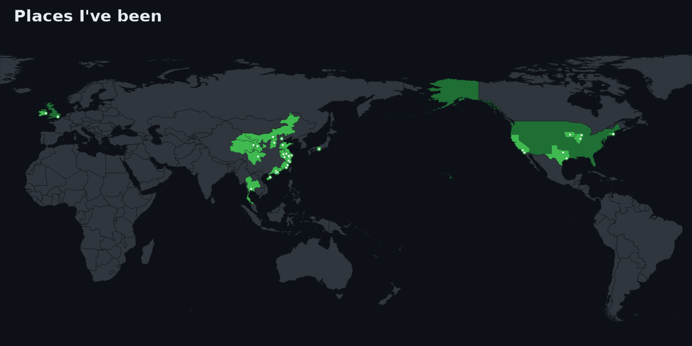

### Hi there 👋

Building random things across academia & industry. Currently in a vibe coding phase.

**🔭 Interests:** · Statistical Learning · Reinforcement Learning · Multi-source Data Fusion 

**🛠️ Tools**

**🌏 Places I've been**

<picture>
  <source media="(prefers-color-scheme: dark)" srcset="https://raw.githubusercontent.com/KenYanL/KenYanL/output/github-snake-dark.svg" />
  <source media="(prefers-color-scheme: light)" srcset="https://raw.githubusercontent.com/KenYanL/KenYanL/output/github-snake.svg" />
  
</picture>
